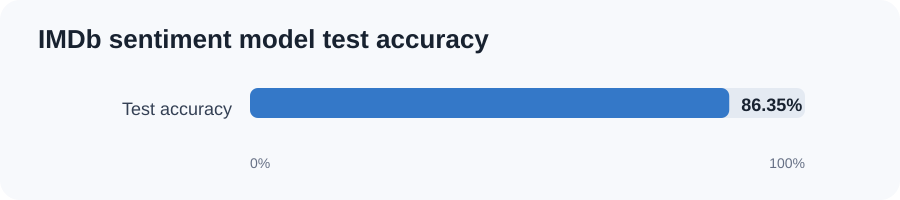

# Movie Review Sentiment Analysis

**Predict whether an IMDb movie review expresses positive or negative sentiment**

  

## Project overview

An NLP binary-classification project that processes IMDb movie reviews and predicts their sentiment: **negative (0)** or **positive (1)**. The notebook uses Keras text preprocessing and an embedding-based neural network.

## Result

| Metric | Recorded result |
|---|---:|
| Test accuracy | **86.35%** |
| Training reviews | 25,000 |
| Test reviews | 25,000 |
| Vocabulary size | 9,908 |

*The accuracy and dataset details are taken from the supplied notebook's recorded outputs.*

## Workflow

1. Load the IMDb training and test reviews.
2. Clean review text by lowercasing and removing HTML break tags and punctuation.
3. Split training data into training and validation subsets.
4. Convert text into integer sequences with Keras `TextVectorization`.
5. Train an embedding-based neural network with dropout and global average pooling.
6. Evaluate the exported preprocessing-and-model pipeline on the held-out test set.
7. Try sample reviews and inspect predicted sentiment scores.

## Model components

- TextVectorization for vocabulary building and tokenization
- Embedding layer for learned word representations
- Dropout for regularization
- GlobalAveragePooling1D for sequence aggregation
- Dense sigmoid output for binary sentiment prediction

## Run the project

Open [`movie_review_sentiment_analysis.ipynb`](movie_review_sentiment_analysis.ipynb) in Jupyter Notebook or Google Colab and run the cells in order. Keras downloads the IMDb dataset on the first run.

## Repository files

- `movie_review_sentiment_analysis.ipynb` — text preprocessing, model training and sample predictions
- `requirements.txt` — Python dependencies
- `assets/test-accuracy.svg` — test-result chart

## Notes

This is an educational NLP project. Predictions are model estimates, not a definitive measure of a review's meaning. Results may vary with random seeds and library versions.
